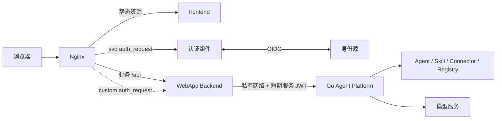

# WebApp 容器部署

本文描述独立应用的外部容器宿主。Agent Platform 仍是普通 standalone 智能体服务，不启用 `--webapp-host=single` 或已经删除的 compose 宿主。此部署不影响 Desktop 的既有 single/bridge 合同。

## 镜像与进程边界

`deploy/webapp/Dockerfile` 构建一个共用镜像：Alpine Linux、Node 24、Nginx、静态 Go Platform，以及镜像宿主脚本。镜像不含 Python、Go 编译器、npm 依赖或具体 WebApp 包。当前构建脚本只生成 Linux amd64 镜像。

同一个镜像由 Compose 启动不同角色，角色分别运行在容器内：

- `prepare`：离线检查目录或 ZIP，安装应用资源，读取认证声明与实例配置，生成 Nginx/认证/Backend/Platform 配置，然后退出。
- `platform`：独立的 Go 智能体服务。只加入 Backend 专用内部网络和模型出站网络，不发布主机端口。
- `backend`：独立的 Node 业务后端。只挂载后端源码、业务数据和自己的服务凭据；只有该角色加入 Platform 内部网络。
- `auth`：用户认证组件，读取自己的 OIDC 配置，不加入 Platform 网络，不持有 Platform 凭据。none/custom 时仍提供私有依赖就绪检查。
- `webapp`：Nginx 静态前端与业务 API 入口。只加入应用网络，持有前端、公开元数据和生成的 Nginx 配置。唯一对外端口属于此角色。



“一套镜像”不表示共用网络命名空间。Nginx、认证服务无法通过服务发现或直接连接访问 Platform；目录挂载也分别限制。普通 Platform 自身仍是可信执行面，这里没有修改其工具权限语义，也没有绕过既有 Linux single 模式的 Landlock/supervisor。

## 清单与三种认证模式

```json
{"authentication":{"mode":"none"}}
```

none 不做用户登录，不向 Backend 注入可信用户身份。它只适合用户明确选择的开放应用或本机演示；Backend→Platform 的服务鉴权在所有模式下均开启。

```json
{"authentication":{"mode":"sso","protocol":"oidc","providerRef":"company-sso"}}
```

SSO 的身份源参数由部署者放在运行目录的 `config/auth.json`，格式参考 `deploy/webapp/auth.example.json`。凭据不进入 ZIP、前端 bootstrap 或业务配置。OIDC 使用 authorization code、S256 PKCE、浏览器绑定的 state 和 nonce，验证 RS256 签名、issuer、audience/azp、时效与 subject。当前不支持把任意 OAuth2 access token 当身份，也不支持其他签名算法。

登录态保存在 auth 进程内，以不透明 HttpOnly、SameSite=Lax Cookie 标识；HTTPS 使用 Secure 与 __Host- 前缀。有效期不超过 ID token 过期时间与八小时，重启会退出登录，不做静默续期。logout 撤销本应用会话，不代表退出整个上游身份源。生产 publicOrigin 必须为 HTTPS；仅显式 allowInsecureLocalhost 可供本机协议测试。TLS 终止由部署入口提供，Nginx 此镜像入口为 HTTP。

SSO 模式下 Backend 无需实现用户登录、Cookie、OIDC/JWT 验证或 CSRF。Nginx 清除客户端伪造的约定身份头，从 auth_request 注入 `X-Webapp-User`（issuer+sub 的 SHA-256）与 URL 编码的 `X-Webapp-Name`，并注入 `X-Webapp-Auth-Mode`。Cookie/Bearer 不传给业务后端，后端 Set-Cookie 不传给浏览器。业务数据的用户归属与授权仍由业务 Backend 负责。

```json
{
  "authentication": {
    "mode": "custom",
    "checkPath": "/api/auth/check",
    "loginPath": "/login",
    "publicPaths": ["/auth-assets/", "/api/auth/login", "/api/auth/callback"]
  }
}
```

custom 由 Backend 自己管理认证、Cookie/Bearer、CSRF 和业务授权。Nginx 的内部子请求直接调用 Backend 的 checkPath，原始方法与 URI 分别通过 X-Original-Method、X-Original-URI 传入；204/其他 2xx 放行、401 未登录、403 禁止，其他状态按鉴权故障处理。检查接口不跳转、不刷新 Cookie。登录路径和 publicPaths 放行，尾随 `/` 表示前缀；checkPath 禁止被公开路径覆盖，也不对浏览器提供。业务 Cookie、Authorization、Set-Cookie 保留。示例审阅 Backend 没有实现 custom 登录业务；选择 custom 的应用必须提供自己的检查和登录接口。

缺少 mode、未知 mode、缺少 SSO 配置、身份源发现失败等不会降级为 none。共享 Manifest 为兼容旧 Desktop 包允许省略 authentication，但镜像安装时必须显式声明。

## 宿主接口

| 可见范围 | 接口 | 行为 |
| --- | --- | --- |
| 浏览器，全部模式 | GET /__webapp/bootstrap.json | 应用公开信息与登录入口，不含身份源凭据 |
| 浏览器，全部模式 | GET /__webapp/client.js | 同源 JSON 请求辅助，SSO 自动携带 CSRF |
| 浏览器，仅 SSO | GET /__auth/login、GET /__auth/callback | OIDC 登录与回调 |
| 浏览器，仅 SSO | GET /__auth/me、GET /__auth/csrf、POST /__auth/logout | 当前身份、CSRF 与退出 |
| 私有服务 | /__internal/auth/check | auth_request 校验；公网访问 404 |
| 私有服务 | /__internal/health/live、/__internal/health/ready | 进程与依赖就绪检查；不代理到公网 |
| 旧命名空间 | /__desktop 与其子路径 | 新 Nginx 入口全部 404；既有 Desktop/single 仍保留 |

不提供额外 auth assets 路由，因为登录页面由 OIDC 身份源或 custom Backend 提供。业务 `/api` 只转发应用 Backend，绝不代理 Platform API。

## 启动、更新与数据

先停止全部服务，再运行 prepare 并重建各角色，不能在旧 Nginx 继续服务时切换认证模式。prepare 在 manifest 与配置验证完成后生成配置；auth/Backend/Platform 健康检查通过且 Nginx `-t` 成功后才启动公共监听。此实现使用完整重启，不支持配置热切换或 Nginx reload。

运行目录整体由用户管理，Compose 分别挂载所需子目录。`app/` 保存安装后的五根应用包，顶层 agents/skills-center/connectors-center 保存 Platform 实际读取的资源；`registries/` 与 `config/platform/` 是实例配置，包内默认值只补缺，升级不会覆盖已有配置。生成的 runtime.yml 保留普通运行时调优与出站代理配置；auth、automation 与 memory 节由镜像固定为私有服务鉴权及禁用后台调度/记忆 worker，不能通过实例配置关闭服务鉴权。`chats/` 是聊天与产物，`webapp-data/` 是业务报告，`logs/` 保存 Platform/Backend/Nginx 日志，`.state/platform/` 保存 Platform 状态，`platform-runtime/` 保存其余运行时派生数据。`host/` 是生成的私有配置与公开前端元数据，不能对外发布整个目录。

不同 appId 不能共用运行目录。包内容改变需显式 WEBAPP_UPDATE=true；相同包重启保留实例配置、Agent/Skill/Connector 修改和聊天；显式更新到内容不同的包才替换包声明的资源。更新只替换包声明的资源，未在新包声明的旧资源不会自动删除，避免误删实例资源；需要移除的历史资源由部署者停机后处理。安装器锁用于拒绝并发 prepare；中断后遗留 `.prepare-lock` 时，先确认没有 prepare 进程再移除锁。prepare 失败时保持公共入口停止，修复后重新执行，不把半完成升级当成成功。

Backend 的 Platform 服务 JWT 每五分钟轮换，有效期十分钟；私钥只挂载 Backend，Platform 只挂载对应公钥和固定 issuer/audience/subject 策略。这里使用专用服务主体，不生成 Desktop owner 或浏览器 ticket。

## 开发验证

```sh
# 在 Platform 仓库执行
node --test deploy/webapp/test/*.test.mjs
go test ./internal/webapp ./cmd/agent-platform
# Docker 策略集成测试，只创建临时项目与目录
node deploy/webapp/test/nginx.integration.mjs
./scripts/build-webapp-image.sh
```

OIDC 自动化使用本地模拟身份源，不能替代真实企业身份源验收。演示规则模型也不是真实 LLM；真实 AI 需要在独立实例 registry 中配置可用模型服务。

## 本次验证范围（2026-11-12）

已在 Docker Desktop 的 Linux amd64 容器验证三种 Nginx 策略、模拟 OIDC 完整登录及 CSRF/身份头边界；独立审阅包已通过 Nginx→Backend→Platform→规则模型的完整链路，SSE 正文、聊天与报告落盘，且 Nginx/auth 到 Platform 的两个私有 IP 均连接失败。相同包重新准备保留实例 Agent、Registry 与报告；缺少 SSO provider 时在改动凭据前失败。镜像内 Node 24.22.3、Nginx 1.28.3，无 Python；Docker 本机报告镜像总占用约 159 MB。真实 OIDC 与真实 LLM 尚未配置验收。验证仅使用临时项目，未切换用户现有容器。
