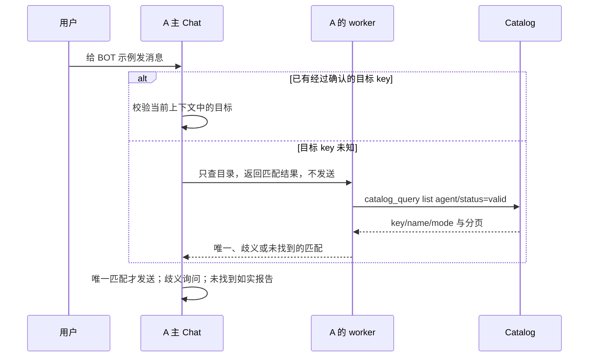
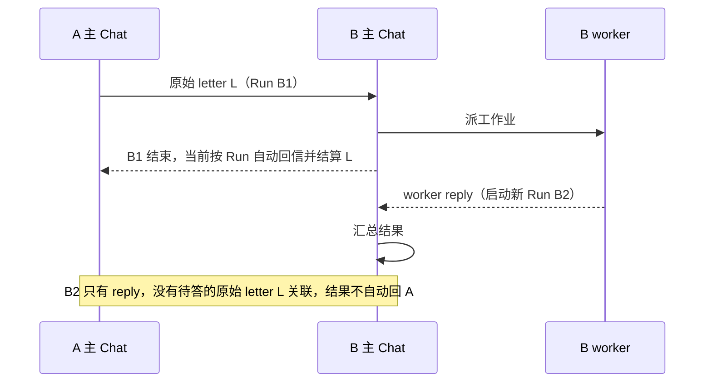

# BOT 全流程复核计划：发现、创建、派工与多层通信

记录日期：2026-11-08（Asia/Shanghai）。

性质：复核计划与问题清单，不是已验收报告。本轮只整理文档，不实施跨 Run 回信改造，不创建测试 BOT、不发送业务消息、不重启运行实例。执行复核时逐项填写证据，不能把源码存在、单测通过或模型口头声称完成当成真实部署验收。

## 1. 目标与范围

从用户自然语言请求出发，复核以下完整链路：

1. 一个 BOT 识别其他 Agent/BOT 或模型的真实标识。
2. 一个 BOT 通过自己的 worker 创建另一个正式 BOT。
3. BOT 主 Chat 向自己的 worker Chat 派工、补充、收取结果与处理请示。
4. 一个 BOT 主 Chat 向另一个 BOT 的主 Chat 发消息或请求工作。
5. 目标 BOT 自己回答，或者派 worker 后在后续 Run 汇总并回给请求方。
6. 并行多个目标、多个来源、多层 BOT、失败、取消、重投与生命周期清理。

本计划覆盖 Platform 源码、内嵌连接器说明、部署提示词及相邻运行数据仓库的 BOT 配置。WebClient/Desktop 的显示、审批与回放纳入联调；gateway 不作为已支持的测试入口。不扩展 GENERAL/CODER/KBASE 的 mode 专属逻辑，不把 BOT 邮件派工等同于 TEAM 编排或 agent_invoke。

相关计划与事实源：

- [Mailbox 后续实施计划](mailbox-next.md)：既有决策与阶段记录；本文件是 BOT 专项复核清单，新增设计建议不视为已确认决策。
- [Mailbox 投递计划](mailbox-delivery.md)、[主 Chat 长上下文计划](primary-chat-long-context.md)。
- [chats.db V2](chats-db-v2.md)：并库仍暂缓，本复核不以并库完成为前置。
- [Mailbox 当前合同](../docs/Mailbox.md)、[智能体配置](../docs/智能体配置说明.md)、[API 与协议](../docs/API与协议.md)。

## 2. 术语与角色边界

| 对象 | 定义与责任 | 不应混淆的对象 |
| --- | --- | --- |
| Agent/BOT | 平台目录中的正式定义，以 agentKey 标识；BOT 为 Native mode | 名为“文档专家”的工作 Chat 不等于正式 Agent |
| 主 Chat | BOT 的调度入口，按实例保存主要聊天指针，同一 Chat 的主 Run 串行出队 | 不是“该 Agent 最近创建的 Chat” |
| worker/分身 | 同一个 BOT 的非主 Chat，执行 Agent 已配置的能力 | 不是独立 Agent，不是 agent_invoke 内联子任务 |
| Run | 一次运行，完成后结束；同一主 Chat 后续收信会启动新的 Run | Run 结束不必然代表整个跨 BOT 工作完成 |
| mail/letter | Chat 地址间投递的工作信，保存来源、收件地址、权限与消费记录 | mailId 不等于 chatId、runId 或 awaitingId |
| reply | 平台根据消费 letter 的 Run 最终输出生成的回信 | 不是通过普通 chat_send 主动再发的一封 letter |
| notify/ask | 中间消息与请示；ask 对应真实等待项 | 不是最终完成，也不能通过发 letter 回答审批 |
| 跨 Run 工作请求 | 待设计：允许目标 BOT 在多次调度 Run 中完成的原始请求 | 当前没有可据此宣称已实现的完整关联与结算合同 |

### 2.1 主 Chat 与 worker 的能力矩阵

| 能力 | BOT 主 Chat 主 lane | BOT worker 主 lane |
| --- | --- | --- |
| 实际工具 | 固定 chat_send/chat_submit/chat_get_status/chat_interrupt/chat_query/action_announce | Agent 有效工具，移除前四个调度工具 |
| catalog_query | 不直接装配；需要时委派 worker | 挂载 builtin.platform-control 且未排除时可用 |
| Agent/模型发现 | 接收 worker 返回的真实标识；聊天模型还可用 chat_query models | catalog_query list 的 agent/model 资源 |
| 发送工作信 | 主 Chat 调用 chat_send | 无 chat_send；发现任务完成后返回主 Chat |
| 管理平台资源 | 委派自己的 worker | 符合 Native root 准入、挂载及审批时执行 catalog_manage |
| 人格与提示词 | SOUL.md、部署 bot.system-prompt、平台直接注入的协议；不加载 Agent AGENTS.md | SOUL.md、Agent AGENTS.md、已配置技能/连接器规则 |
| chat_notify | 不在固定六工具中 | 原本有效时保留；当前只通知打开本 Run 的 letter 发件方 |
| 规划与嵌套派工 | BOT 不支持规划 | 不通过 worker 再开 worker，不使用 agent_invoke 替代 BOT 通信 |

BTW/explain 保留原有只读旁路合同，不参与此处的主 Chat 调度、派工与代批。

## 3. 本次工作形成的基线

以下状态仅反映本次代码与文件检查，不能推断所有运行实例已部署同一版本。

| 项目 | 当前状态 | 仍需验证 |
| --- | --- | --- |
| 主 Chat 根据 worker 能力判断任务 | 提示词修订已提交，Platform 提交 b93e59b2 | 实际部署提示词加载、模型不再因自己缺执行工具拒绝 |
| botLumi 平台管理能力 | 初始修订已提交到 zenmind-env，提交 a8a5144c；后续指令仍有工作区修改 | 运行实例是否加载新 revision，worker 实际可调用工具 |
| BOT 创建 defaults | 当前工作区增加 type:bot，读取 BotSettings.DefaultAgent | 尚未提交/部署；缺 worker 默认模型时不借用调度模型或 GENERAL 默认 |
| BOT 创建说明与示例 | 内嵌平台控制连接器新增 references/bot.md；运行数据仓库新增 agents/bot.demo/ | 示例仍未提交；模型 key、包挂载、加载诊断及实际运行 |
| 发现目标再由主 Chat 发送 | 当前工作区已修改部署/示例提示词、直接注入协议、工具说明、botLumi 和 bot.demo 指令 | 真实模型遵循两阶段流程，唯一/歧义/未找到处理正确 |
| botLumi 旧工作指令 | 已有新规则，但 AGENTS.md 仍残留固定 newChat、继承当前 Run 模型、普通 wait 等旧段落 | 这些段落不得被复制为当前协议；需单独审查并清理冲突，不能只在末尾追加新规则 |
| 直接跨 BOT 请求的回信 | 已有按 Run 生成回信的实现；用户报告直接回答能够收到 | 在固定版本下重现并保存证据 |
| 目标 BOT 派 worker 后的跨 Run 回信 | 用户已报告丢失；源码能解释该现象 | 尚未实施修复，尚无端到端通过证据 |

本次已运行并通过的相关包检查：internal/platformcontrol、internal/connector、internal/runtime/session、internal/llm、internal/config、internal/runops。不同批次运行覆盖这些包，不能据此标记后述真实模型用例通过。已核对两份部署 BOT 提示词一致且为英文；bot.demo 的英文模板与连接器示例一致，工具/连接器能力沿用 botLumi。

### 3.1 文件与模块入口

| 事项 | 入口 |
| --- | --- |
| 主 Chat 装配、worker 工具过滤 | internal/runtime/session/primary_chat.go、session_builder.go |
| 主 Chat 模型可见工具说明 | internal/llm/primary_chat_tools.go |
| 部署提示词 | configs/agent-prompt.example.yml；实际 configs/agent-prompt.yml 为忽略文件，不提交 |
| 调度模型与预置能力 | configs/agent-settings.example.yml；实际部署配置独立核对 |
| 平台控制发现/创建 | internal/platformcontrol/control_handler.go、control_validation.go、tool_handler.go、bot_defaults_test.go |
| 管理源码发布与审批 | internal/adminsource、internal/catalog |
| 目标准入、主 Chat 路由、运行回调 | internal/runtime/query/mailbox.go |
| 工具发送、通知、请示、控制 | internal/runops/mail_*.go、tool_handler.go |
| 邮件受理、消费、自动回信与幂等 | internal/mailbox/service.go、store.go、types.go、interactions.go |
| 主 Chat 直接注入协议 | internal/resources/connectors/builtin.task-control/skills/task-control/references/primary-chat.md |
| 连接器发现与创建说明 | internal/resources/connectors/builtin.platform-control/skills/platform-control/references/catalog.md、bot.md |
| 实际机器人与可复制示例 | 相邻 zenmind-env/agents/botLumi/、agents/bot.demo/、agents/README.md |

Platform 根目录没有当前受管的 agents 示例树，根 /agents/ 在忽略规则中；不要误把示例写进 runtime 的 ru-agents，也不要提交真实配置与凭据。

## 4. 流程一：发现 Agent/BOT 和模型

### 4.1 目标流程



- 查询 Agent：catalog_query `{action:"list",args:{resourceType:"agent",status:"valid"}}`。
- 查询模型：resourceType 使用 `model`，返回注册表 modelKey，不把 Provider modelId 当成平台 key。
- primary 的 chat_query models 可直接查询聊天模型与支持的思考等级，不能用它代替 Agent 目录。
- worker 先读已挂载平台控制技能；按需跟进分页，不能用第一页没看到证明不存在。
- 用目录返回的 key/name/mode 匹配用户目标。不要猜 example/demo/sample 等 key 并逐个试发，不读文件系统绕过发现，不把失败目标替换成 coder-devassist 等无关对象。
- invocable 是 agent_invoke 静态资格，不是 BOT 发信资格；BOT 不能作为 agent_invoke 目标，不代表不能 chat_send。
- 目录找不到但源目录有 bot.demo 时，应核对当前实例 runtime/config-dir、加载诊断、模型配置与 revision；不能直接认定这个运行实例已有该 Agent。

## 5. 流程二：从一个 BOT 创建另一个 BOT

目标链路：A 主 Chat → A worker → Platform Control → 发布新 BOT B → A 汇总创建结果。

1. A 根据用户意图区分“正式 Agent/BOT”和“开工作 Chat”。不能通过改建工作 Chat 假装创建正式 BOT；若用户用途明确，避免无必要的反复确认。
2. A worker 必须挂载 builtin.platform-control，且 catalog_query/catalog_manage 不在 excludeTools 中。仅写工具名或增加提示词不能获得挂载能力；主 Chat 不直接执行管理工具。
3. worker 使用 defaults `{type:"bot"}` 取 worker 创建默认值；此入口为当前未部署修订，老运行实例可能拒绝 bot，须明确版本条件，不伪造接口已可用。
4. 确认真实可用模型与思考等级；补充 key、name、mode:BOT。保持 Native，不配置规划、ACP 或 proxy。不要把用户仅要求的“文档处理 Agent”一律变成 BOT。
5. 参考连接器 bot.md 与 agents/bot.demo 三文件模板。能力来自全局/BOT presets、Agent 显式配置与挂载；tools:[] 不清空预置，技能/Memory 不隐式补工具。
6. 针对 agent.yml 执行 validate → apply → 回读。创建时 key 与 resourceKey 一致；修改已有资源使用完整源文件与正确 baseRevision，不能覆盖未知字段。不能经管理工具修改调用 Agent 自身。
7. 分别发布 SOUL.md 与 AGENTS.md，逐文件校验、审批与回读；三文件目前不是一次原子事务。部分成功时报告具体已发布/失败文件，不宣称完整创建。
8. 普通 apply 走当前审批策略；Agent accessConfig 的新增、移除或修改始终人工确认，delete 始终人工确认。默认权限不因“创建机器人”而自动升高。
9. B 的主 Chat 指针独立于定义创建。通过现有 primary:true / 主聊天管理入口选择，或 chat_send 省略 chatId/newChat 时由平台按既有合同补建；普通新 Chat 是 worker，不应误标主 Chat 已存在。
10. 创建验证分四步记账：源码发布成功、Catalog 有效、模型能运行、调度与回信能完成。前一步成功不替代后一步。

部署级 bot.dispatch 与 bot.system-prompt 不随一次 Agent 创建自动改写。普通 BOT 可无 Workspace；@root 表示通用根目录工作环境而非目录授权；项目意图另须具体现存 Workspace 与 isProject:true。

## 6. 流程三：BOT 与自己的 worker 通信

### 6.1 派工与续办

- 新独立工作：主 Chat 调用 chat_send `{newChat:true,message,...}`，省略 agentKey 指向自己；按模型支持显式选择 reasoningEffort。
- 同一任务后续补充：复用已确认的 worker chatId；不能继续附加仅适用于 newChat 的模型、思考、权限或名称覆盖。
- 省略 worker 模型/思考使用 Agent 配置，不继承主 Chat 调度模型；示例以 HIGH 派复杂任务，纯机械低风险单步可 MEDIUM。
- BOT 主 Chat 新开自分身的 accessLevel 省略或 default，在原子受理时继承父实时档位并冻结，不使用更高 Agent 默认绕过权限。
- files 传附件路径并由平台复制字节；不要只在 message 粘贴发送方 @chat 路径。references 选择资源，不授予额外工具或权限。

### 6.2 收件与回信

- 主 Chat 串行处理用户消息、letter、reply、notify、ask；不向运行中的 BOT 主 Chat 插入主 lane 消息。
- 派单后结束当前调度 Run，由回信唤起后续 Run；主 Chat 没有 wait，不能按旧指令阻塞等待，也不能忙轮询。
- worker 直接执行并返回完整最终答案，平台自动回信；不再 chat_send 一封“完成信”。worker 无 chat_send/chat_submit/chat_get_status/chat_interrupt，chat_notify 原本有效时保留。
- 接单回执不是执行结果。主 Chat 区分 accepted/delivery/status/outcome，不从 mailId、runId 的存在推断任务完成。
- 同 Run 内多封 letter 的回信按发件 Chat 分组；同一次终态回调重入不能重复回信。

### 6.3 请示、审批与控制

- ask 映射真实 awaitingId，主 Chat 用 chat_submit 精确作答；人可通过原等待项 /api/submit 作答。chat_send 不是 submit。
- 代批按主 Chat 当前权限重评冻结操作，硬禁止、readonly、强制人工审批不放宽。
- 只有 letter delivery=started 授予发信方该 Run 的控制；inserted、reply、notify 不授予控制。
- letter 派生 Run 对 chat_get_status/chat_interrupt 及 run.terminal 等待保留 run_chaining_not_allowed；不得因有工具定义就承诺可控整条后代链。

## 7. 流程四：BOT 与其他 BOT 通信

### 7.1 发往目标主 Chat

已确认目标 B 为 BOT 后，由 A 主 Chat 调用：

```json
{"agentKey":"<confirmed-B-key>","message":"<user-requested message>"}
```

- 省略 chatId/newChat，路由到 B 主 Chat；同时省略 chatName/modelKey/reasoningEffort/accessLevel 等 newChat 专用覆盖。
- 外部 Agent 不能创建、发现、读取或控制 B 的 worker；不能让 A 直接把任务投给 B 的分身。
- “普通执行任务派给自己的 worker”与“按用户明确要求给其他 Agent 发消息”应在提示词中分开，不能用自分身限制禁止合法跨 BOT 发信。
- 只要求发送：根据投递收据报告排队/受理等真实状态，不承诺天气等业务结果已完成。
- 要求完成工作：必须拿到与原请求关联的业务结果；B 的接单回复不等于其 worker 完成。
- 转发相对日期时固定用户时区与具体日期。天气可做真实联调，但回信链路自动化测试应优先用固定标记结果，避免网络与预报变化干扰。

### 7.2 已知 P0：目标派工后结果不能跨 Run 回上游

用户现场报告：A 请求 B、C；两者自己答时 A 能收到；两者派 worker 时各自收到结果，但 A 收不到后续业务内容。此报告尚未在本次固定测试环境重演，源码检查发现与之吻合的缺口：



检查入口：

- runtime/query/mailbox.go 的 RuntimeComplete 将当次 Run 最终文本送给 mailbox.Completed。
- mailbox/service.go 的 Completed 只读取 Store.ByRun(completion.RunID)，仅为 Delivered 且 AnsweredBy 为空的 agent letter 分组生成回信。
- B1 的 letter 在 Store.Complete 中写入 AnsweredBy/终态；B2 消费的是 worker reply，不会自动继承 B1 上游。
- ReplyKey 的幂等粒度是当前 Run 与发件 Chat，不是跨多次 Run 的工作请求。

因此不能只改提示词，也不能让 B 用普通 chat_send 把所有后续输出主动寄给 A：那是新的 letter，可能触发反向自动回信、循环及多来源串信。

## 8. 跨 Run 与多层回信：待确认设计

本节为建议与复核要求，尚未编码，不改变现有“一 Run 一次正式回信、不加 final 标志”的已确认合同。实施前必须在 mailbox-next.md 形成明确增量决策，不能直接照本节猜测接口。

### 8.1 必须解决的语义

| 决策 | 建议方向 | 复核问题 |
| --- | --- | --- |
| 工作身份 | 原始请求、派工、结果有平台生成并冻结的关联 | 复用哪个已有标识，是否新增请求实体/边；不能只靠正文中的 ID |
| 同 Run 多封请求 | 保留每封原请求的来源与完成范围 | 当前按发件 Chat 合并回信是否继续保留？同一 A 连发两件工作时如何分别结算？ |
| 接单与完成 | 派工结束当前调度 Run 不提前关闭业务请求 | 原有 Run 回信保留为接单信息，还是 BOT 派工阶段延迟最终结算？必须明确 |
| 最终完成信号 | 有可验证的结算依据，不猜模型自然语言 | 多 worker 等全部、部分返回、追加派工、主动终止如何表达？是否需要工具合同调整？ |
| 结果路由 | 根据可信关联只回原请求方 Chat/subject | 多来源共用 B 主 Chat 时怎样防串信，不允许“最近发信人”推断 |
| 去重与重试 | 请求级结算与结果发布具备持久幂等键 | 崩溃窗口、重复 RuntimeComplete、重复 worker reply 如何只结算一次 |
| 失败与生命周期 | 失败、取消、删除、归档、缺附件均有明确终态/恢复方式 | 已受理回信仍按现有合同投递；不能悄悄丢失 |

关联状态由 mailbox 拥有；runtime 只提供真实消费/完成/派工上下文，server 保持薄适配。平台派生关联不能写入原样保存的 query 请求体，也不能接受模型伪造上游身份。关系存储按需索引查询，不每次遍历全部 Chat 或回读 JSONL 猜链路。

结果路由不授予新控制权、历史读取权或目录访问；不得让 A 因请求 B 而直接控制 B 的 worker。三文件配置发布与多 Run 请求完成也不能混为同一种事务。

### 8.2 多层链路

目标复核拓扑：

```text
用户 → A 主 Chat
       ├→ B 主 Chat → B worker → B 汇总 → A
       ├→ C 主 Chat → C worker → C 汇总 → A
       └→ D 主 Chat → E 主 Chat → E worker → E 汇总 → D 汇总 → A
```

- worker 不递归派工；更多层级发生在有准入的 BOT 主 Chat 之间。
- 回信逐层沿对应原请求收束，不默认跳过中间 BOT 把内部 worker 结果直接广播给 A。
- 并行支路可独立返回；A 是否等全部、先报部分结果、遇失败终止，要按该用户任务的完成条件记录，不能因第一个结果到达就清空所有请求。
- 默认 mail.max-hops 为 4；发送 letter/notify/ask 与自动 reply 都递增，自动最终回信不受普通发送相同方式的硬截断。接收直接用户消息才重置，不能伪造 user origin 续跳。
- 最简单 A→B→worker→B→A 的因果 hop 为 1/2/3/4。更多层级的自动回信可能超过 4，而途中继续普通发信会受限制；必须按实际 MailHop/发送校验测试，不能仅凭拓扑层数宣布支持任意深度。
- hop 限制和工作请求的完成关联分开设计；不能通过提高默认跳数掩盖当前跨 Run 关联缺口。
- A→B→A、重复转交与互相接单要有终止条件；新增请求级关联不得制造无人输入下的无限聊天。

## 9. 权限、附件与请示的跨层复核

1. 自分身新开 Run 与跨 Agent 目标默认权限的规则分别核对，不能一概写“全链继承父权限”。Agent 自动生成 reply/notify/ask 按收件 Agent 默认权限创建；新关联不能偷偷改变这套授权。
2. 原始用户指令、目录结果、Chat 归属、邮件投递资格与 Run 控制是不同证据。找到 key 不等于能读历史、代批任意等待项或控制目标后代。
3. B worker 的 ask 先送 B；是否需要进一步让 A 处理，是待确认的多层请示语义，当前不能声称自动透传。人工应能在原 waiting item 精确作答；跨层转发也不能扩大审批能力。
4. files 在每层复制/冻结字节，artifact_publish 自动回信附件只覆盖实际回答 Run；若 worker 产物由 B 后续 Run 回 A，必须复核 B 是否需要重新发布或有受控转交机制。不能只转发 @chat 文本路径。
5. 失败、重复、未知结果不能盲目重发写任务；请求级关联不能绕过原调用幂等与审批收据。
6. 当前重启会清空独立 mail.db、取消未完成 Run；不承诺新关联可跨重启恢复。若要改变，单独制定存储与恢复合同，不在此次复核顺带推进并库。

## 10. 复核用例矩阵

状态初始均为待执行。每个用例记录版本、调用与结果，不因相关单测历史通过自动勾选。

| ID | 优先级 | 场景 | 通过条件 |
| --- | --- | --- | --- |
| ENV-01 | P0 | 固定同一 Platform 实例、runtime、配置与模型 | A/B/C 在有效目录，主 Chat 指针与加载 revision 清楚 |
| ENV-02 | P0 | 实际提示词与示例一致性 | 部署英文调度提示加载；旧 wait/猜 key/禁跨 BOT 指令不覆盖新规则 |
| DISC-01 | P0 | 按“BOT 示例”发现 | worker 用 Catalog 返回真实 key/name/mode，primary 不尝试直接调用 catalog_query |
| DISC-02 | P1 | 目标在后续分页/同名多项/不存在 | 正确分页、澄清或未找到，不试发猜测 key，不换目标 |
| DISC-03 | P1 | Agent 与模型发现 | Agent key/modelKey/provider modelId 不混淆，BOT invocable:false 不误判为不能通信 |
| DISC-04 | P1 | 未挂平台控制或 catalog_query 被排除 | 报准确能力缺口，不扫目录、端口或凭据 |
| CREATE-01 | P0 | A 请求创建 B | A worker defaults(bot)→validate→审批→apply→回读三文件，正式 B 可发现 |
| CREATE-02 | P1 | worker 默认模型缺失、模型不支持思考等级 | 显示缺项或选择真实支持模型，不借用 scheduler 默认，不发占位 key |
| CREATE-03 | P1 | key 冲突、陈旧 revision、禁止自修改 | 不覆盖已有资源、不借 Bash 绕过；错误可定位 |
| CREATE-04 | P1 | 三文件中途失败或只完成配置发布 | 如实报告部分完成，不宣称可正常调度 |
| CREATE-05 | P1 | accessConfig 变化/default/auto_approve/full_access | 强制人工项不被代批或自动审批放宽 |
| SELF-01 | P0 | A 新开 worker 完成固定标记任务 | 受理→worker→自动回信→A 汇总，主 Chat 不 wait，最终结果完整 |
| SELF-02 | P1 | 同一任务补充与新任务 | 正确复用 chatId/新开 newChat；仅新建参数不混用 |
| SELF-03 | P1 | worker 问题、审批、用户抢先作答 | chat_submit 精确作用于等待项，already_resolved 停止，无重复执行 |
| SELF-04 | P1 | worker 尝试嵌套派工或控制他人 Run | 工具装配/准入拒绝，reply 不授予 Run 控制 |
| CROSS-01 | P0 | A 向 B 主 Chat 发送普通消息 | A 使用真实 key、不传 newChat/chatId，回执准确，B worker 不被外部创建 |
| CROSS-02 | P0 | B 直接回答工作请求 | A 恰好收到对应最终结果，关联原 letter |
| CROSS-03 | P0 | B 派一个 worker 后汇总 | A 收到后续业务结果，接单回复不提前结算；当前已知缺口的最小复现 |
| CROSS-04 | P0 | A 同时请求 B、C，两者各派 worker | A 各收到一次完整结果，不漏任一支、不因先到结果提前全部完成 |
| CROSS-05 | P0 | A、D 同时请求 B，结果乱序 | B 回给正确来源/subject，不按最近发件人串信 |
| CROSS-06 | P1 | B 同一请求多个 worker、部分失败、追加派工 | 请求完成条件明确，部分结果与最终结算区分正确 |
| LEVEL-01 | P0 | A→B→D→worker 后逐层汇总 | 每层保持上游关联，无环路、无越级控制，明确 hop 下的可执行范围 |
| LEVEL-02 | P1 | hop 达边界后继续发信、最终回信 | 普通发送明确拒绝、自动最终回信符合既有合同，不重置 origin 绕过 |
| LEVEL-03 | P1 | A→B→A 或重复转交 | 不形成无限自动回信/派单，终止状态可解释 |
| FILE-01 | P1 | 输入文件与最终产物跨 worker/B/A | 接收端独立回读字节、hash/名称正确，无无效发送方 @chat 路径 |
| LIFE-01 | P0 | 终态回调重复、回复重复、投递结果未知 | 不重复执行任务、不重复最终结算，不盲目重发 |
| LIFE-02 | P1 | worker/目标错误、取消、超时 | 来源收到准确失败/取消结果，不长期显示假进行中 |
| LIFE-03 | P1 | 任一 Chat 删除、归档、恢复归档 | 按现有关闭合同处理，已受理回信不被错误撤回，不复活旧 mail |
| LIFE-04 | P1 | 重启后待办、指针与历史 Chat | 明确 mail 清空与 Run 取消，BOT worker 列表/历史身份不依赖旧 mail |
| UI-01 | P1 | 主 Chat、worker、收件箱与回放 | 主 Chat 简洁展示、worker detailed；来源与状态准确，回放不改归属 |

## 11. 执行方法与证据模板

### 11.1 顺序

1. 保存当前工作区差异与两个仓库的提交基线，区分本次未提交修订与其他无关改动，不混提交。
2. 在明确的验收实例准备 A/B/C；模型与权限显式记录，使用固定文本标记如 CASE-CROSS-04-B，而不是完全依赖联网天气。
3. 先跑 DISC/CREATE/SELF/CROSS-01/02 确认基础能力，再固定复现 CROSS-03/04，记录当前失败证据。
4. 对 §8 作增量设计评审后才能修改 Runtime/Mailbox；补失败回归，再实施关联与结算。
5. 修复后覆盖多来源、并行、多层、失败、附件、审批、生命周期，再进行真实模型与 UI 联调。
6. 最后才更新已实现文档、部署并记录端到端结果；不要为验收中途重启而丢失正在观察的 mail。

### 11.2 自动化与人工联调

针对变化执行相应包测试；建议基础命令：

```bash
go test ./internal/platformcontrol ./internal/catalog ./internal/connector
go test ./internal/runtime/session ./internal/runtime/query ./internal/runops ./internal/llm
go test ./internal/mailbox
git diff --check
```

这组命令是复核建议，本次文档整理没有重新执行这些测试。新增回归应验证状态机与实际路由，不只断言提示词字符串。跨 Run 关联涉及事务与回调竞争时，追加定向竞态测试。真实模型联调另外记录，不由 fake port 单测替代。

### 11.3 每例记录

```text
用例 ID / 日期与用户时区：
Platform 与 zenmind-env commit / dirty 状态 / 实际运行版本：
实例标识、runtime/config-dir（不记录凭据）：
A/B/C 的 agentKey / 有效 revision / 主 Chat ID：
worker 模型与思考 / dispatch 模型与思考 / 实际权限：
用户请求与预期完成条件：
每次工具参数（脱敏）、返回收据：
每层 mailId、kind、from/to Chat、fromRunId、消费 runId、hop：
原 letter 的 AnsweredBy、ReplyKey、状态变化与最终接收者：
新请求关联证据（若已实现；不能用自由文本替代可信状态）：
附件 manifest/hash、waiting/approval 精确标识（适用时）：
模型可见历史与 UI/回放证据：
期望 / 实际 / 通过或失败 / 缺口 / 修复提交：
```

证据通过受支持的管理读取、测试桩及受控日志收集；不要让业务 Agent 扫描凭据或直接读写运行数据库作为正常工作流程。调试数据不得提交真实 token、私钥或用户文件正文。

## 12. 本轮复核完成标准

- [ ] 三个 BOT 在指定实例可发现，能力、模型、主 Chat 指针与实际 revision 均有证据。
- [ ] 主 Chat/worker/正式 Agent 的职责区分一致，提示词、技能说明、工具装配与准入无冲突。
- [ ] 发现和创建全流程通过，worker 查目录，主 Chat 使用真实 key 发往另一 BOT 主 Chat。
- [ ] CROSS-03/04/05 的原始问题已先复现，并有修复后的并行、多来源回归证据。
- [ ] 跨 Run 接单与完成、幂等关联、多 worker 聚合、失败/取消等设计已确认并落到实现，而非只补提示词。
- [ ] 多层链路在已声明 hop 范围内可解释、可收束，无自动回信循环，无越权读取/控制/代批。
- [ ] 附件、原等待项、归档删除与重启边界都有实际结果，没有把暂缓的恢复能力写成已交付。
- [ ] 原样 query 保存、可信平台元数据、Server/Runtime/Mailbox 模块边界不被本次改造破坏。
- [ ] 全部 P0 通过，P1 有通过证据或明确保留项与影响；部署版本与源码版本一致。
- [ ] 完成记录回填本计划，事实文档更新为真实实现，残余缺口独立列出。
