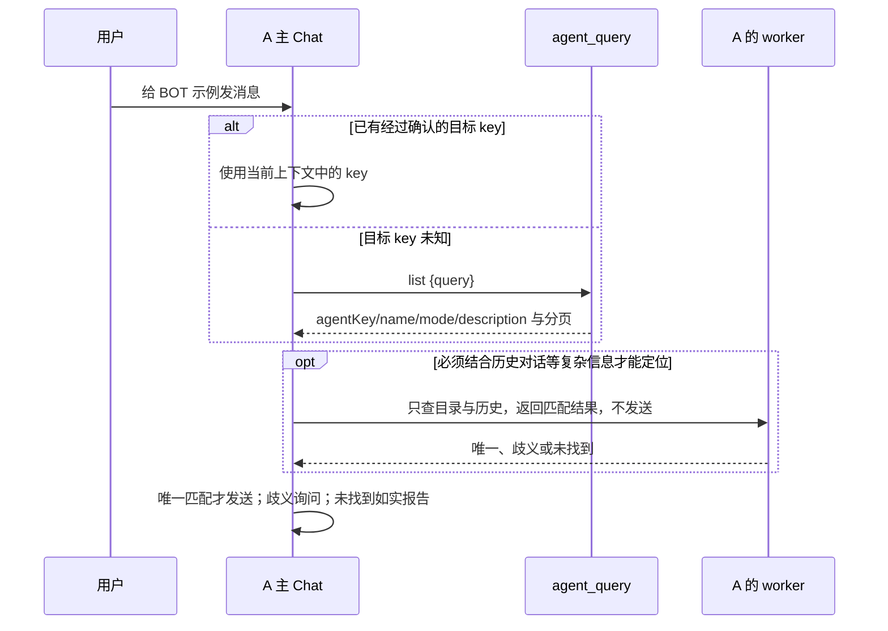
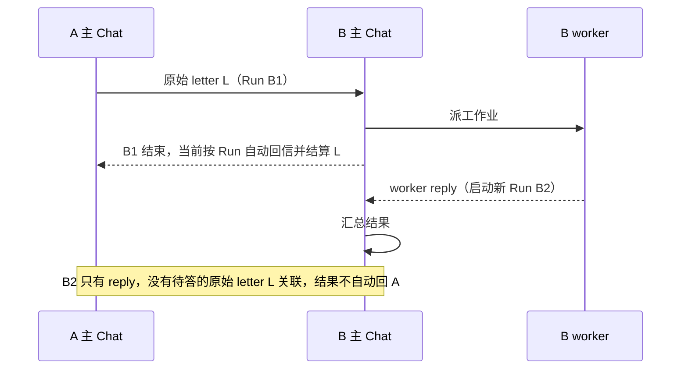

# BOT 全流程方案与复核计划：发现、创建、派工与多层回传

记录日期：2026-11-08（Asia/Shanghai）。

性质：方案与复核清单，不是已验收报告。§8 的跨 Run 回传方案已与用户确认，尚未编码；§4 的主 Chat 自查目标同样尚未实施。执行复核时逐项填写证据，不能把源码存在、单测通过或模型口头声称完成当成真实部署验收。实施完成前，[docs/Mailbox.md](../docs/Mailbox.md) 仍是当前合同。

## 1. 目标与范围

从用户自然语言请求出发，方案与复核覆盖以下完整链路：

1. BOT 主 Chat 自己查到其他 Agent/BOT 的真实 key，复杂情况才委派 worker。
2. 一个 BOT 通过自己的 worker 创建另一个正式 BOT。
3. BOT 主 Chat 向自己的 worker Chat 派工、补充、收取结果与处理请示。
4. 一个 BOT 主 Chat 向另一个 BOT 的主 Chat 发消息或请求工作。
5. 目标 BOT 自己回答，或者派 worker 后在后续 Run 汇总；无论哪种，请求方只收到一次最终结果。
6. 并行多个目标、多个来源、多层 BOT、失败、取消、重投与生命周期清理。
7. 普通 Agent 的 mailbox 使用同一套回传规则：别人发来的信总要回。

本计划覆盖 Platform 源码、内嵌连接器说明、部署提示词及相邻运行数据仓库的 BOT 配置。WebClient/Desktop 的显示、审批与回放纳入联调；gateway 不作为已支持的测试入口。回传规则按 mail 因果关系判断，不按 mode 分支；不扩展 GENERAL/CODER/KBASE 的 mode 专属逻辑，不把 BOT 邮件派工等同于 TEAM 编排或 agent_invoke。

相关计划与事实源：

- [Mailbox 后续实施计划](mailbox-next.md)：既有决策与阶段记录；本文件 §8 是对其回信、插入与跳数合同的增量决定。
- [Mailbox 投递计划](mailbox-delivery.md)、[主 Chat 长上下文计划](primary-chat-long-context.md)。
- [chats.db V2](chats-db-v2.md)：并库仍暂缓，本方案不以并库完成为前置。
- [Mailbox 当前合同](../docs/Mailbox.md)、[智能体配置](../docs/智能体配置说明.md)、[API 与协议](../docs/API与协议.md)。

## 2. 术语与角色边界

| 对象 | 定义与责任 | 不应混淆的对象 |
| --- | --- | --- |
| Agent/BOT | 平台目录中的正式定义，以 agentKey 标识；BOT 为 Native mode | 名为“文档专家”的工作 Chat 不等于正式 Agent |
| 主 Chat | BOT 的调度入口，按实例保存主要聊天指针，同一 Chat 的主 Run 串行出队，每个 Run 只处理一封 mail | 不是“该 Agent 最近创建的 Chat” |
| worker/分身 | 同一个 BOT 的非主 Chat，执行 Agent 已配置的能力 | 不是独立 Agent，不是 agent_invoke 内联子任务 |
| Run | 一次运行，完成后结束；同一主 Chat 后续收信会启动新的 Run | Run 结束不必然代表整件事完成 |
| mail/letter | Chat 地址间投递的工作信，保存来源、收件地址、权限与消费记录 | mailId 不等于 chatId、runId 或 awaitingId |
| reply | 平台对原信的回答，正文是接手这件事的 Run 的最终输出 | 不是通过普通 chat_send 主动再发的一封 letter |
| notify/ask | 中间消息与请示；ask 对应真实等待项 | 不是最终完成，也不能通过发 letter 回答审批 |
| 原信 | 收件方需要回复的 Agent 来信 | 用户消息、Automation 输入没有回信，不是原信 |
| 子信 | Run 在办某封原信期间发出的 letter，PARENT 指向该原信 | 不是同一件事的补充信 |
| 在办的事 | Run 正在替哪件事工作：一组同发信 Chat、同 PARENT 的 Agent 来信（以第一封为代表），或“用户” | 不是 Run 消费过的全部 mail |

### 2.1 主 Chat 与 worker 的能力矩阵

| 能力 | BOT 主 Chat 主 lane | BOT worker 主 lane |
| --- | --- | --- |
| 实际工具 | 当前固定 chat_send/chat_submit/chat_get_status/chat_interrupt/chat_query/action_announce；方案加入 agent_query，共七个 | Agent 有效工具，移除前四个调度工具 |
| catalog_query | 不直接装配；需要时委派 worker | 挂载 builtin.platform-control 且未排除时可用 |
| Agent 发现 | 方案：agent_query 自查；需要结合历史对话等复杂定位时委派 worker | catalog_query list 的 agent 资源 |
| 模型发现 | chat_query models | catalog_query list 的 model 资源 |
| 发送工作信 | 主 Chat 调用 chat_send | 无 chat_send；发现任务完成后返回主 Chat |
| 管理平台资源 | 委派自己的 worker | 符合 Native root 准入、挂载及审批时执行 catalog_manage |
| 人格与提示词 | SOUL.md、部署 bot.system-prompt、平台直接注入的协议；不加载 Agent AGENTS.md | SOUL.md、Agent AGENTS.md、已配置技能/连接器规则 |
| 读取分身内容 | chat_query read/artifacts 可读同一 BOT 的分身，只要求同一用户；外部 Agent 不能发现 BOT 分身（internal/conversation/primary.go botWorkerVisible） | — |
| chat_notify | 不在固定工具中 | 原本有效时保留；只通知打开本 Run 的 letter 发件方 |
| 规划与嵌套派工 | BOT 不支持规划 | 不通过 worker 再开 worker，不使用 agent_invoke 替代 BOT 通信 |

BTW/explain 保留原有只读旁路合同，不参与此处的主 Chat 调度、派工与代批。

## 3. 当前基线

以下状态仅反映源码与文件检查，不能推断所有运行实例已部署同一版本。

| 项目 | 当前状态 | 仍需验证或处理 |
| --- | --- | --- |
| 主 Chat 根据 worker 能力判断任务 | Platform b93e59b2 已提交 | 实际部署提示词加载、模型不再因自己缺执行工具拒绝 |
| botLumi 平台管理能力 | zenmind-env a8a5144c 已提交 | 运行实例是否加载新 revision，worker 实际可调用工具 |
| BOT 创建 defaults | Platform 7e64510e 已提交 `catalog_query defaults {type:"bot"}`，读取 BotSettings.DefaultAgent | 尚未部署验证；缺 worker 默认模型时不借用调度模型或 GENERAL 默认 |
| BOT 创建说明与示例 | Platform 7e64510e 新增 platform-control references/bot.md；zenmind-env 9e7ef1af 新增 agents/bot.demo/ | 模型 key、包挂载、加载诊断及实际运行 |
| 目标发现 | 当前提示词、primary-chat.md、botLumi 与 bot.demo 指令要求 worker 用 catalog_query 查、主 Chat 发送 | 方案改为主 Chat 用 agent_query 自查（§4）；实施时同步改写这些指令 |
| botLumi 旧工作指令 | AGENTS.md 仍残留固定 newChat、继承当前 Run 模型、普通 wait 等段落 | BOT 主 Chat 没有 wait，派活后结束本轮；需原地清理冲突段落，不能只在末尾追加新规则 |
| 直接跨 BOT 请求的回信 | 已有按 Run 生成回信的实现；用户报告直接回答能够收到 | 在固定版本下重现并保存证据 |
| 目标 BOT 派 worker 后的跨 Run 回信 | 用户已报告丢失；源码能解释该现象（§7.2） | 方案见 §8，尚未实施，尚无端到端通过证据 |

整理首版计划时运行并通过：internal/platformcontrol、internal/connector、internal/runtime/session、internal/llm、internal/config、internal/runops。不同批次运行覆盖这些包，不能据此标记后述真实模型用例通过。已核对两份部署 BOT 提示词一致且为英文；bot.demo 的英文模板与连接器示例一致，工具/连接器能力沿用 botLumi。

### 3.1 文件与模块入口

| 事项 | 入口 |
| --- | --- |
| 主 Chat 装配、worker 工具过滤 | internal/runtime/session/primary_chat.go、session_builder.go；固定工具清单 internal/contracts/tool_admission.go |
| 主 Chat 模型可见工具说明 | internal/llm/primary_chat_tools.go |
| 部署提示词 | configs/agent-prompt.example.yml；实际 configs/agent-prompt.yml 为忽略文件，不提交 |
| 调度模型与预置能力 | configs/agent-settings.example.yml；实际部署配置独立核对 |
| 平台控制发现/创建 | internal/platformcontrol/control_handler.go、control_validation.go、tool_handler.go、bot_defaults_test.go |
| task-control 工具归属与动作 | internal/connector/native.go、control_actions.go；工具定义 internal/resources/tools/*.yml、internal/tools/builtin_tool_definitions.go、internal/resources/builtin_tool_catalog.yml |
| 管理源码发布与审批 | internal/adminsource、internal/catalog |
| 目标准入、主 Chat 路由、插入/排队、运行回调 | internal/runtime/query/mailbox.go |
| 工具发送、通知、请示、控制 | internal/runops/mailbox.go、tool_handler.go |
| 邮件受理、消费、自动回信与幂等 | internal/mailbox/service.go、store.go、types.go、interactions.go、files.go |
| 普通 Agent 的 wait | internal/tools/tool_wait.go |
| 主 Chat 直接注入协议 | internal/resources/connectors/builtin.task-control/skills/task-control/references/primary-chat.md |
| 连接器发现与创建说明 | internal/resources/connectors/builtin.platform-control/skills/platform-control/references/catalog.md、bot.md；task-control SKILL.md、references/chat.md、mailbox.md |
| 实际机器人与可复制示例 | 相邻 zenmind-env/agents/botLumi/、agents/bot.demo/、agents/README.md |

Platform 根目录没有当前受管的 agents 示例树，根 /agents/ 在忽略规则中；不要误把示例写进 runtime 的 ru-agents，也不要提交真实配置与凭据。

## 4. 流程一：发现 Agent/BOT 和模型

### 4.1 目标流程（方案）



- Agent 查询与 Chat 查询分开：新增独立工具 `agent_query {action:"list", args:{query?, limit?, cursor?}}`；chat_query 保持只查会话，其 models 动作维持现状。
- agent_query 只返回 status valid 的公开 Agent，字段为 agentKey/name/mode/description，与 catalog_query list agent 的公开摘要同源。query 对 key/name/description 做不区分大小写的包含匹配；按 nextCursor 翻页，空页也要跟进。
- agent_query 归 builtin.task-control，作为 chat_send 的通讯录；BOT 主 Chat 固定工具加入 agent_query。普通 Agent 按挂载与 excludeTools 获得。它只读，不授予发信资格之外的能力；目标资格仍由 chat_send 准入判断，不暴露任何 BOT 的 worker。
- 只有需要结合历史对话、多轮澄清才能定位目标时，主 Chat 才委派有 catalog_query 的 worker；worker 只返回结果，不发送。
- 查询模型：主 Chat 用 chat_query models，worker 用 catalog_query resourceType model；返回注册表 modelKey，不把 Provider modelId 当成平台 key。
- 用返回的 key/name/mode 匹配用户目标。不要猜 example/demo/sample 等 key 并逐个试发，不读文件系统绕过发现，不把失败目标替换成 coder-devassist 等无关对象。
- invocable 是 agent_invoke 静态资格，不是 BOT 发信资格；BOT 不能作为 agent_invoke 目标，不代表不能 chat_send。
- 目录找不到但源目录有 bot.demo 时，应核对当前实例 runtime/config-dir、加载诊断、模型配置与 revision；不能直接认定这个运行实例已有该 Agent。

示例：用户说“给 BOT 示例发消息：明天开会”。A1 调用 `agent_query {action:"list",args:{query:"示例"}}`，得到 `[{agentKey:"bot.demo",name:"BOT 示例",mode:"BOT"}]`；唯一匹配，调用 `chat_send {agentKey:"bot.demo",message:"明天开会"}`。

## 5. 流程二：从一个 BOT 创建另一个 BOT

目标链路：A 主 Chat → A worker → Platform Control → 发布新 BOT B → A 汇总创建结果。创建交给 worker 执行，主 Chat 不直接执行管理工具。

1. A 根据用户意图区分“正式 Agent/BOT”和“开工作 Chat”。不能通过改建工作 Chat 假装创建正式 BOT；若用户用途明确，避免无必要的反复确认。
2. A worker 必须挂载 builtin.platform-control，且 catalog_query/catalog_manage 不在 excludeTools 中。仅写工具名或增加提示词不能获得挂载能力。
3. worker 使用 defaults `{type:"bot"}` 取 worker 创建默认值；该入口已在 7e64510e 提交，未部署实例可能仍拒绝 bot，须明确版本条件，不伪造接口已可用。
4. 确认真实可用模型与思考等级；补充 key、name、mode:BOT。保持 Native，不配置规划、ACP 或 proxy。不要把用户仅要求的“文档处理 Agent”一律变成 BOT。
5. 参考连接器 bot.md 与 agents/bot.demo 三文件模板。能力来自全局/BOT presets、Agent 显式配置与挂载；tools:[] 不清空预置，技能/Memory 不隐式补工具。
6. 针对 agent.yml 执行 validate → apply → 回读。创建时 key 与 resourceKey 一致；修改已有资源使用完整源文件与正确 baseRevision，不能覆盖未知字段。不能经管理工具修改调用 Agent 自身。
7. 分别发布 SOUL.md 与 AGENTS.md，逐文件校验、审批与回读；三文件目前不是一次原子事务。部分成功时报告具体已发布/失败文件，不宣称完整创建。
8. 普通 apply 走当前审批策略；Agent accessConfig 的新增、移除或修改始终人工确认，delete 始终人工确认。默认权限不因“创建机器人”而自动升高。
9. B 的主 Chat 指针独立于定义创建。通过现有 primary:true / 主聊天管理入口选择，或 chat_send 省略 chatId/newChat 时由平台按既有合同补建；普通新 Chat 是 worker，不应误标主 Chat 已存在。
10. 创建验证分四步记账：源码发布成功、Catalog 有效、模型能运行、调度与回信能完成。前一步成功不替代后一步。

部署级 bot.dispatch 与 bot.system-prompt 不随一次 Agent 创建自动改写。普通 BOT 可无 Workspace；@root 表示通用根目录工作环境而非目录授权；项目意图另须具体现存 Workspace 与 isProject:true。

## 6. 流程三：BOT 与自己的 worker 通信

### 6.1 派工与续办

- 新独立工作：主 Chat 调用 chat_send `{newChat:true,message,...}`，省略 agentKey 指向自己；按模型支持显式选择 reasoningEffort。
- 同一任务后续补充：复用已确认的 worker chatId；不能继续附加仅适用于 newChat 的模型、思考、权限或名称覆盖。
- 省略 worker 模型/思考使用 Agent 配置，不继承主 Chat 调度模型；示例以 HIGH 派复杂任务，纯机械低风险单步可 MEDIUM。
- BOT 主 Chat 新开自分身的 accessLevel 省略或 default，在原子受理时继承父实时档位并冻结，不使用更高 Agent 默认绕过权限。
- files 传附件路径并由平台复制字节；不要只在 message 粘贴发送方 @chat 路径。references 选择资源，不授予额外工具或权限。
- 不同请求方的工作不要复用同一个 worker：即使平台按 §8.2 排队避免回信串联，worker 的历史记录仍含前一件事的内容。

### 6.2 收件与回信

- 主 Chat 串行处理用户消息、letter、reply、notify、ask；不向运行中的 BOT 主 Chat 插入主 lane 消息。
- 派单后结束当前调度 Run，由回信唤起后续 Run；主 Chat 没有 wait，不能按旧指令阻塞等待，也不能忙轮询。
- worker 直接执行并返回完整最终答案，平台自动回信；不再 chat_send 一封“完成信”。worker 无 chat_send/chat_submit/chat_get_status/chat_interrupt，chat_notify 原本有效时保留。
- 方案后不再产生接单回信：主 Chat 在办某封原信时派出子信并结束，平台不回信，等子信都回来后由接手的 Run 回一次（§8）。chat_send 收据只代表受理；查看进度用 chat_get_status {mailId}，方案后返回 waiting（还有几项没回来）。
- 主 Chat 区分 accepted/delivery/status/outcome，不从 mailId、runId 的存在推断任务完成。
- 同一终态回调重入不能重复回信。

### 6.3 请示、审批与控制

- ask 映射真实 awaitingId，主 Chat 用 chat_submit 精确作答；人可通过原等待项 /api/submit 作答。chat_send 不是 submit。
- 代批按主 Chat 当前权限重评冻结操作，硬禁止、readonly、强制人工审批不放宽。
- 只有 letter delivery=started 授予发信方该 Run 的控制；inserted、reply、notify 不授予控制。
- letter 派生 Run 对 chat_get_status/chat_interrupt 及 run.terminal 等待保留 run_chaining_not_allowed；不得因有工具定义就承诺可控整条后代链。
- 请示在 BOT 层断开：worker 的请示只到本 BOT 主 Chat，不再上报给请求方 BOT（§8.8）。

## 7. 流程四：BOT 与其他 BOT 通信

### 7.1 发往目标主 Chat

已确认目标 B 为 BOT 后，由 A 主 Chat 调用：

```json
{"agentKey":"<confirmed-B-key>","message":"<user-requested message>"}
```

- 省略 chatId/newChat，路由到 B 主 Chat；同时省略 chatName/modelKey/reasoningEffort/accessLevel 等 newChat 专用覆盖。
- 外部 Agent 不能创建、发现、读取或控制 B 的 worker；不能让 A 直接把任务投给 B 的分身。
- “普通执行任务派给自己的 worker”与“按用户明确要求给其他 Agent 发消息”应在提示词中分开，不能用自分身限制禁止合法跨 BOT 发信。
- 只要求发送：根据投递收据报告排队/受理等真实状态，不承诺业务结果已完成。
- 要求完成工作：方案后 B 不回接单，A 收到的这封信的回信就是 B 对这件事的最终结果；B 自己答或派 worker 后汇总，A 都只收到一次。
- 转发相对日期时固定用户时区与具体日期。天气可做真实联调，但回信链路自动化测试应优先用固定标记结果，避免网络与预报变化干扰。

### 7.2 现状缺口：目标派工后结果不能跨 Run 回上游（方案实施前）

用户现场报告：A 请求 B、C；两者自己答时 A 能收到；两者派 worker 时各自收到结果，但 A 收不到后续业务内容。此报告尚未在固定测试环境重演，源码检查发现与之吻合的缺口：



- runtime/query/mailbox.go 的 RuntimeComplete 将当次 Run 最终文本送给 mailbox.Completed。
- mailbox/service.go 的 Completed 只读取 Store.ByRun(completion.RunID)，仅为 Delivered 且 AnsweredBy 为空的 agent letter 分组生成回信。
- B1 的 letter 在 Store.Complete 中写入 AnsweredBy/终态；B2 消费的是 worker reply，不会自动继承 B1 上游。
- ReplyKey 的幂等粒度是当前 Run 与发件 Chat，不是跨多次 Run 的工作。
- 根因是 BOT 主 Chat 没有 wait。普通 Agent 在同一 Run 中 wait，回信插入同一 Run，最终输出已含结果，所以此前未暴露。

不能只改提示词，也不能让 B 用普通 chat_send 把后续输出主动寄给 A：那是新的 letter，会触发反向自动回信、循环及多来源串信。修复方案见 §8。

现状另有三个相关缺陷，同样由 §8 处理：

- 同一 worker 同时替两个来源干活时，补充信插入同一 Run（runtime/query/mailbox.go MailTarget 末段），一封回信回答两件事，汇总后串到两边。
- 回信附件只取本 Run artifact_publish 的文件（mailbox/files.go replyFiles），BOT 主 Chat 没有该工具，worker 产物到主 Chat 即断。
- 回信也计跳；修好跨 Run 回传后，A→B→worker→B→A 回到 A 时已是第 4 跳，三层链路收回后各层都不能再派活。

## 8. 跨 Run 回传方案（已确认，尚未实施）

### 8.1 已确认的决定

1. Agent 查询与 Chat 查询分开：新增独立工具 agent_query，主 Chat 自查目标（§4）。
2. 回传规则对所有 Agent 的 mailbox 生效，不只 BOT：别人发来的信总要回。
3. 不发接单回信：信任 mailbox 投递，原信只在拿到最终结果时回一次。
4. 关系用 MAILS 现有表的字段记录，不新增 link 表；平台判断只看字段，不读信头文字；从回信沿 PARENT 一路追溯到用户，用户是终点。
5. 产物自动逐层流转，并记录在 MAILS 的 FILES_ 中。
6. 一个 Run 只办一件事；插入规则对普通 Agent 同样生效。
7. 请示在 BOT 层断开：BOT A 请 BOT B 办事，B 的 worker 需要审批时只到 B 主 Chat，A 不再收到。
8. 回信不加跳。
9. letter/reply/notify/ask 四种 mail 不变，不新增 kind。

agent_query 命名与归属、复用 PARENT_MAIL_ID_、插入规则对普通 Agent 的两处行为变化（§8.7）及回信不加跳，按 2026-11-08 方案写入；实施前如有异议在此修改。

### 8.2 一个 Run 只办一件事

“一件事”是同一发信 Chat、同一 PARENT 的一组 Agent 来信（以组内第一封为代表），或者“用户”。用户消息、Automation 及非 mail 开出的 Run 在办用户的事。

一封 mail 只有和运行中的 Run 属于同一件事才插入，否则排队：

| 到达的 mail | 运行中 Run 在办的事 | 结果 |
| --- | --- | --- |
| 用户消息 | 任意 | 照旧可插入；BOT 主 Chat、规划、压缩等现有排队规则不变 |
| Agent 来信 M | 一组 Agent 来信，M 与组内信同发信 Chat、同 PARENT | 插入并入该组，最终只回一封（现有补充合并语义） |
| Agent 来信 M | 其他，包括用户的事 | 排队，前一个 Run 结束后单独开 Run |
| 回信/即时消息/请示 M | 等于 work(M) | 插入，可唤醒 wait |
| 回信/即时消息/请示 M | 不等于 work(M) | 排队，不唤醒 wait |

因此 Run 在办的事由开出它的 mail 或用户输入决定，整个 Run 期间不变；每封 mail 只需一个 PARENT，追溯是单链。BOT 主 Chat 本来就一个 Run 一封 mail，规则对它没有额外影响。

### 8.3 字段

| 字段（已有） | letter | reply | notify / ask |
| --- | --- | --- | --- |
| PARENT_MAIL_ID_ | 发信 Run 当时在办的那封信；为空表示在办用户的事 | 它回答的那封信（组代表） | 发件 Run 在办的那封信（现有含义） |
| ANSWERED_BY_MAIL_ID_ | 回答它的回信 | — | — |
| REPLY_OF_RUN_ID_ | — | 接手这件事并生成回信的 Run | — |
| FILES_ | 发信附件 | 接手 Run 的产物加上各子回信的产物；每项增加 fromMailId | 不变 |
| HOP_ | 发件 Run 跳数 + 1 | 接手 Run 的跳数，不再加一 | 发件 Run 跳数 + 1 |

- PARENT_MAIL_ID_ 对四种 mail 统一为一个含义：产生这封 mail 的 Run，当时在替哪封信办事。
- 新增索引 `IDX_MAILS_PARENT_ ON MAILS(PARENT_MAIL_ID_,KIND_)`，用于查子信。mail.db 每次启动清库，直接修改未上线基线，不迁移。
- Run 在办的事不另存字段：由开出它的 mail 按字段推出；运行期可与 MailHop 一样缓存在 RunControl。
- 回信键沿用 `run:<runId>:<toChatId>` 格式，但 runId 改为接手 Run，不再取原信的 RUN_ID_。

### 8.4 平台判断

```text
work(mail)：收件 Run 因这封 mail 在办哪件事
  Agent 来信       → 这封信本身（并入同组时取组内第一封）
  回信/即时/请示   → mail.PARENT 指向的那封信的 PARENT（为空即用户）
  用户/Automation  → 用户

发信（chat_send）：新信.PARENT = 发信 Run 在办的事（用户则为空）

Run 结束（在办的事为 U）：
  U 为用户 → 终点，不回信
  若存在 KIND_=letter 且 PARENT_=U 的子信 c，满足任一：
      c 未到终态（done/failed/discarded）
      c.ANSWERED_BY 指向的回信尚未被消费（不是 delivered/discarded）
    → 不回信，U 保持 delivered
  否则在同一事务中：
      生成回信 PARENT=U、REPLY_OF_RUN=本 Run、键 run:<本 Run>:<U 的发信 Chat>
      FILES = 本 Run 产物 + 各子回信 FILES
      U 及同组未回复的信写 ANSWERED_BY 并转为 done
```

- 判断只看子信是否回来，不看 Run 是成功、失败还是取消：B1 派完活后出错，worker 结果回来后 B2 仍可汇总回复。
- 没有子信的 Run 照旧在结束时立即回信；普通 Agent 在同一 Run 中 wait 到全部回信时，行为与现在一致。
- 子信失败（含收件 Chat 被删）时，其失败回信照常寄回在办方，消费后算“回来了”。
- 同组信：BOT 主 Chat 中只有原信本身；普通 Chat 中为与代表信同 RUN_ID_、同发信 Chat、同 PARENT 且未回复的信。

### 8.5 示例

**示例 1：A 请 B 办事，B 派 worker**

| mail | 方向 | PARENT | 消费它的 Run | ANSWERED_BY | REPLY_OF_RUN | 跳数 |
| --- | --- | --- | --- | --- | --- | --- |
| L1 | A 主 → B 主 | 空（A1 在办用户的事） | B1 | R1 | | 1 |
| L2 | B 主 → W | L1 | W1 | R2 | | 2 |
| R2 | W → B 主 | L2 | B2 | | W1 | 2 |
| R1 | B 主 → A 主 | L1 | A2 | | B2 | 2 |

1. B1 结束：在办 L1；查出 PARENT_=L1 的 L2 未到终态，不回信，L1 保持 delivered。现状在此把“已安排”寄给 A。
2. W1 结束：在办 L2，没有子信，生成 R2，L2 转为 done。
3. R2 投递开出 B2：在办 R2.PARENT(L2).PARENT = L1。
4. B2 结束：L2 已 done、R2 已消费，全部回来；生成 R1 寄往 L1 的发信 Chat（A 主），L1 转为 done，附带 R2 的产物。
5. A2 结束：在办 L1.PARENT = 空，即用户；终点，结果显示给用户。

**示例 2：B 派两个 worker，一个失败**

| 步 | Run | 做了什么 | 平台 |
| --- | --- | --- | --- |
| 1 | B1 | 收 L1，发 L2→W1、L3→W2 | 两封 PARENT 都是 L1；不回信 |
| 2 | B2 | 收 W2 的失败回信 | L2 未回，不回信；B2 可补派 L4（PARENT=L1），也可什么都不做 |
| 3 | B3 | 收 W1 的回信 | 若没有补派，L1 名下全部回来，B3 的输出（含 W2 失败说明）寄给 A |

**示例 3：三层 A→D→E→E 的 worker**

| 步 | Run | 现规则跳数 | 新规则跳数 | 做了什么 |
| --- | --- | --- | --- | --- |
| 1 | A1 | 0 | 0 | 发 L1 给 D（PARENT 空） |
| 2 | D1 | 1 | 1 | 发 L2 给 E（PARENT=L1），结束，不回信 |
| 3 | E1 | 2 | 2 | 发 L3 给 worker（PARENT=L2），结束，不回信 |
| 4 | W1 | 3 | 3 | 做完，回信 R3 |
| 5 | E2 | 4 | 3 | 汇总，接手 L2，回 D |
| 6 | D2 | 5 | 3 | 汇总，接手 L1，回 A |
| 7 | A2 | 6 | 3 | 告诉用户 |

追溯链为 `R3 → L3 → L2 → L1 → 空（用户）`。现规则下 E2 起各层都不能再派活；新规则下每层还能再派一轮。产物路径：W1 发布 → 复制到 E 主 → 随 E 的回信复制到 D 主 → 随 D 的回信复制到 A 主。

**示例 4：A 和 D 同时找 B**

| 步 | Run | 做了什么 | 平台 |
| --- | --- | --- | --- |
| 1 | B1 | 收 A 的 L1，派 W1 | L2.PARENT=L1 |
| 2 | B2 | 收 D 的 L5，派 W2 | L6.PARENT=L5 |
| 3 | B3 | 收 W2 先到的回信 | R6 → L6 → L5，回给 D |
| 4 | B4 | 收 W1 的回信 | R2 → L2 → L1，回给 A |

结果按字段路由，与先后顺序、最近发信人无关。变体：B2 把 L6 发给仍在为 L2 工作的 W1，两封信同发信 Chat 但 PARENT 不同，不是同一件事，L6 排队；W1 先回 L2，再开 Run 处理 L6，两封回信分开。

### 8.6 产物流转

- 回信只带产物：接手 Run 用 artifact_publish 发布的文件，加上这件事所有子回信带来的文件。letter 的输入附件和 notify 的文件不向上传。
- FILES_ 每项记录来源：自己的产物 fromMailId 为空，转来的写来源回信 ID，例如 `{name:"report.pdf", sha256:"…", path:"mail/R1/report.pdf", source:"mail/R2/report.pdf", fromMailId:"R2"}`。
- 按 sha256 去重；同名不同内容改名为 `report (2).pdf`。每经过一层复制一份字节到收件 Chat 的 `mail/<replyId>/`，大小沿用现有附件限制；复制失败按现有规则挂起回信，保留完整结果。
- BOT 主 Chat 不需要 artifact_publish，也不需要额外读权限：子回信的文件已随回信复制进主 Chat 目录。

### 8.7 普通 Agent 场景

普通 Agent 同样会被主动投递：Chat 空闲时回信到达会自动开 Run（runtime/query/mailbox.go MailTarget 末行 StartRunID）。wait 不是必需的，只是让结果在同一 Run 中回来，且总时长受 Run lifetime 限制（internal/tools/tool_wait.go）。

| 场景 | 现在 | 方案后 |
| --- | --- | --- |
| X 发信后 wait，回信在同一 Run 中到达 | 回信插入，X 的最终输出回给 P | 不变 |
| X 发信后不等，直接结束 | 立即把“已发出”回给 P | 延后；回信到达时自动开 X2，X2 汇总后回给 P |
| X 的 wait 超时后结束（例如目标 BOT 派了 worker） | 同上一行现状 | 同上一行方案；长时下游工作建议直接结束 |
| X 的 Chat 里用户正在对话时，别的 Agent 来信 | 插入用户这一轮，这一轮的回答寄给发信方 | **排队**，用户这一轮结束后单独开 Run，回答只寄给发信方 |
| X1 正在等 L2 的回信，另一件事 U' 的回信先到 | 插入 X1 并唤醒，两件事混在一轮 | **排队**，不唤醒 X1；X1 结束后开 X2 处理 U' |
| 用户在 X 的 Chat 里补充 | 插入 | 不变 |
| X 在办用户的事，回信到达 | 开新 Run 输出给用户 | 不变（终点） |

加粗两行是普通 Agent 的行为变化，目的都是不串信。TEAM 总控作为主 Agent 根 Run 使用同一规则；agent_invoke 子任务与 Team 成员仍不能 chat_send。

### 8.8 请示

请示在 BOT 层断开，现有代码已满足，不需要新增转发：

- 请示只从“由信开出、正在等待”的 Run 产生，寄往那封信的发信方（mailbox/interactions.go ObserveEvent）。
- BOT 主 Chat 处理请示的 Run 由请示开出，不是由信开出；主 Chat 也没有会产生等待项的工具，所以请示不会再走向 A。
- 请示的 PARENT 是 worker 在办的子信（如 L2），所以 B 处理请示的 Run 在办 L1；它结束时 L2 未回，不回 A。
- B 主 Chat 按自己的实时档位代批，或留给人在原等待项上处理；审批超时按现有规则拒绝，结果随 worker 回信向上传。

### 8.9 跳数

- letter、notify、ask 为发件 Run 跳数 + 1；回信等于接手 Run 的跳数，不再加一。
- 信的链条每发一封都加一，仍会在 mail.max-hops 处终止，不会无限派活；结果往回传不再占用往下派活的额度。
- 接收用户直接输入才重置为 0；默认上限仍为 4。
- docs/Mailbox.md 的跳数步骤表需要按新规则重算。

### 8.10 收尾与生命周期

- 原信名下最后一项子回信被人工丢弃时，平台给原信寄一封失败回信（键 `letter:<原信 ID>`），正文说明哪封子信的结果被丢弃。
- 在办方 Chat 被删除或归档：原信仍为 delivered（非终态），按现有关闭钩子失败并给发信方寄失败回信；子信按现有规则处理。
- 发信方 Chat 被删除：原信不再生成回信，子工作照常结束，结果留在在办方。
- 重复终态回调：回信键唯一，事务内复查原信尚未回复，只结算一次。
- 重启：mail.db 清空，延后中的原信与字段关系全部丢失，未完成 Run 取消；不恢复，与现有合同一致。

### 8.11 信头与模型可见信息

信头文字由字段在投递时生成，只供模型理解；平台判断不读取信头。

- letter：`Your final answer will be sent back as the reply. If you send letters for this work and end the run, the reply is sent after their replies return, from the run that handles the last one.`
- reply，完成原信时：`This completes letter L1 from agent "bot.a" (chat c_a); your final answer in this run will be sent to it as the reply.`
- reply，原信仍有未回子信时：`Letter L1 from agent "bot.a" still awaits 1 other reply; your final answer in this run will not be sent yet.`
- chat_get_status {mailId}：delivered 的原信返回 waiting（未回子信数），不暴露在办方的 worker Chat 或 Run。

### 8.12 合同与文档改写点

实施时原地改写下列句子，不追加例外：

- docs/Mailbox.md “信与回信”：一个 Run 只正式回一次 → 原信由接手这件事、结束时名下子信都已回来的 Run 回一次；回信正文是接手 Run 的最终输出；回信键使用接手 Run。
- docs/Mailbox.md 补充合并：只有同一件事（同发信 Chat、同 PARENT）才插入合并，其余排队。
- docs/Mailbox.md 跳数第 2 条与步骤表；关系字段说明中 PARENT_MAIL_ID_ 的含义；回信附件来源。
- task-control references/primary-chat.md：发现改为 agent_query；删除 “A BOT main Chat may acknowledge work before its workers finish…” 一句；补充不发接单与 waiting。
- task-control SKILL.md、references/chat.md、mailbox.md：agent_query、插入排队与延后回信。
- platform-control references/catalog.md、bot.md：Agent 发现入口。
- AGENTS.md：Agent 发现（catalog_query 之外的 agent_query）、task-control 工具清单、BOT 主聊天固定工具、Mailbox 回信与插入描述。
- zenmind-env 的 botLumi 与 bot.demo 指令：发现改由主 Chat 执行，清理 wait 等旧段落。
- mailbox-next.md 入口说明。

### 8.13 代码改动入口

| 模块 | 改动 |
| --- | --- |
| internal/mailbox/store.go | 索引 IDX_MAILS_PARENT_；查子信；Complete 按接手 Run 计算回信键 |
| internal/mailbox/service.go | Send 写 PARENT；Completed 按 §8.4 判断；回信跳数不加一；renderHeader 生成新信头；discard 后收尾 |
| internal/mailbox/files.go、types.go | 回信合并子回信产物；File 增加 fromMailId |
| internal/mailbox/interactions.go | notify/ask 的 PARENT 改用 Run 在办的事（与当前 StartedLetter 结果一致时不变） |
| internal/runtime/query/mailbox.go | MailTarget 插入前按 §8.2 判断同一件事，否则排队 |
| internal/runops/mailbox.go | chat_get_status 返回 waiting |
| agent_query | 工具定义 internal/resources/tools/agent_query.yml、builtin_tool_definitions.go、builtin_tool_catalog.yml；归属 internal/connector/native.go 与 control_actions.go；处理器复用 platformcontrol 的 agent 列表；BOT 固定工具 internal/contracts/tool_admission.go；说明 internal/llm/primary_chat_tools.go |
| 提示词与文档 | §8.12 所列 |

Server 层不改。关系状态由 mailbox 拥有，runtime 只提供消费/完成/插入上下文；平台派生字段不写入原样保存的 query，模型不能填写或伪造 PARENT。

### 8.14 留待后续讨论

- A 撤回或取消已交给 B、仍在延后中的工作：当前做不到；B 主 Chat 由信开出的 Run 也不能 chat_interrupt 自己的 worker。
- Automation 发给 BOT 时，执行记录很可能只记下第一轮派单输出，属同类问题，入口待核实。
- 规划 Run 由信开出时的回传语义未覆盖。
- 是否调整 mail.max-hops 默认值，待新跳数规则联调后再定。

## 9. 权限、附件与请示的跨层复核

1. 自分身新开 Run 与跨 Agent 目标默认权限的规则分别核对，不能一概写“全链继承父权限”。Agent 自动生成 reply/notify/ask 按收件 Agent 默认权限创建；PARENT 关系不改变这套授权。
2. 原始用户指令、目录结果、Chat 归属、邮件投递资格与 Run 控制是不同证据。找到 key 不等于能读历史、代批任意等待项或控制目标后代；回传路由不授予新控制权、历史读取权或目录访问。
3. 请示在 BOT 层断开：B worker 的 ask 只到 B 主 Chat；人应能在原 waiting item 精确作答；不跨 Agent 转发审批。
4. files 在每层复制/冻结字节；产物按 §8.6 随回信逐层复制，B 不需要重新发布；不能只转发 @chat 文本路径。
5. 失败、重复、未知结果不能盲目重发写任务；回传不能绕过原调用幂等与审批收据。
6. 当前重启会清空独立 mail.db、取消未完成 Run；不承诺延后中的工作跨重启恢复。若要改变，单独制定存储与恢复合同，不在此次顺带推进并库。

## 10. 复核用例矩阵

状态初始均为待执行。每个用例记录版本、调用与结果，不因相关单测历史通过自动勾选。标注“方案”的用例在 §8 或 §4 实施后才有通过条件。

| ID | 优先级 | 场景 | 通过条件 |
| --- | --- | --- | --- |
| ENV-01 | P0 | 固定同一 Platform 实例、runtime、配置与模型 | A/B/C 在有效目录，主 Chat 指针与加载 revision 清楚 |
| ENV-02 | P0 | 实际提示词与示例一致性 | 部署英文调度提示加载；旧 wait/猜 key/禁跨 BOT 指令不覆盖新规则 |
| DISC-01 | P0 | 方案：按“BOT 示例”发现 | 主 Chat 用 agent_query 拿到真实 key/name/mode 后发送，不委派 worker、不调用 catalog_query |
| DISC-02 | P1 | 目标在后续分页/同名多项/不存在 | 正确分页、澄清或未找到，不试发猜测 key，不换目标 |
| DISC-03 | P1 | Agent 与模型发现 | Agent key/modelKey/provider modelId 不混淆，BOT invocable:false 不误判为不能通信 |
| DISC-04 | P1 | agent_query 未挂载或被排除 | 报准确能力缺口，不扫目录、端口或凭据 |
| DISC-05 | P1 | 需结合历史对话才能定位目标 | 主 Chat 委派有 catalog_query 的 worker，worker 只返回结果不发送 |
| CREATE-01 | P0 | A 请求创建 B | A worker defaults(bot)→validate→审批→apply→回读三文件，正式 B 可发现 |
| CREATE-02 | P1 | worker 默认模型缺失、模型不支持思考等级 | 显示缺项或选择真实支持模型，不借用 scheduler 默认，不发占位 key |
| CREATE-03 | P1 | key 冲突、陈旧 revision、禁止自修改 | 不覆盖已有资源、不借 Bash 绕过；错误可定位 |
| CREATE-04 | P1 | 三文件中途失败或只完成配置发布 | 如实报告部分完成，不宣称可正常调度 |
| CREATE-05 | P1 | accessConfig 变化/default/auto_approve/full_access | 强制人工项不被代批或自动审批放宽 |
| SELF-01 | P0 | A 新开 worker 完成固定标记任务 | 受理→worker→自动回信→A 汇总，主 Chat 不 wait，最终结果完整 |
| SELF-02 | P1 | 同一任务补充与新任务 | 正确复用 chatId/新开 newChat；仅新建参数不混用 |
| SELF-03 | P1 | worker 问题、审批、用户抢先作答 | chat_submit 精确作用于等待项，already_resolved 停止，无重复执行 |
| SELF-04 | P1 | worker 尝试嵌套派工或控制他人 Run | 工具装配/准入拒绝，reply 不授予 Run 控制 |
| CROSS-01 | P0 | A 向 B 主 Chat 发送普通消息 | A 使用真实 key、不传 newChat/chatId，回执准确，B worker 不被外部创建 |
| CROSS-02 | P0 | B 直接回答工作请求 | A 恰好收到一次对应最终结果 |
| CROSS-03 | P0 | 方案：B 派一个 worker 后汇总 | B1 不回信；A 只收到一次 B2 的最终结果；mail.db 中 L2.PARENT=L1、R1.REPLY_OF_RUN=B2。实施前先复现现状失败 |
| CROSS-04 | P0 | A 同时请求 B、C，两者各派 worker | A 各收到一次完整结果，不漏任一支 |
| CROSS-05 | P0 | A、D 同时请求 B，结果乱序 | 按 PARENT 回给正确来源，不按最近发件人串信 |
| CROSS-06 | P1 | B 同一请求多个 worker、部分失败、追加派工 | 子信全部回来前不回信；追加子信 PARENT 指向原信；最后接手的 Run 回一次 |
| CROSS-07 | P0 | 方案：同一 worker 被不同来源复用 | 不同 PARENT 的信排队不插入，两封回信分开 |
| LEVEL-01 | P0 | 方案：A→D→E→worker 后逐层汇总 | PARENT 链可追溯到用户；按新跳数规则各层收回后仍可再派一轮；无越级控制 |
| LEVEL-02 | P1 | hop 达边界后继续发信、最终回信 | 普通发送明确拒绝，回信照常寄出，不重置 origin 绕过 |
| LEVEL-03 | P1 | A→B→A 或重复转交 | 信的跳数逐封递增并在上限终止，无无限自动回信/派单 |
| ORD-01 | P0 | 普通 Agent 发信后 wait | 回信插入同一 Run，行为与现状一致 |
| ORD-02 | P0 | 方案：普通 Agent 发信后直接结束 | 原信延后；回信自动开新 Run 接手并回复发信方一次 |
| ORD-03 | P1 | 方案：用户正在对话时别的 Agent 来信 | 来信排队，回答只寄给发信方，不含用户这一轮的输出 |
| ORD-04 | P1 | 方案：wait 中另一件事的回信先到 | 该回信排队，不唤醒 wait |
| FILE-01 | P1 | 方案：产物跨 worker/B/A | 每层 FILES_ 记 fromMailId，sha 一致，同名改名；输入附件与 notify 文件不上传 |
| ASK-01 | P1 | B worker 请示，B 主 Chat 批不了 | 请示只到 B 主 Chat，A 不收到；B 处理请示的 Run 不回 A；人可在原等待项作答 |
| LIFE-01 | P0 | 终态回调重复、回复重复、投递结果未知 | 不重复执行任务、不重复最终结算，不盲目重发 |
| LIFE-02 | P1 | worker/目标错误、取消、超时 | 来源收到准确失败/取消结果，不长期显示假进行中 |
| LIFE-03 | P1 | 任一 Chat 删除、归档、恢复归档，含原信延后中 | 按现有关闭合同处理；在办方关闭时原信失败并回信；不复活旧 mail |
| LIFE-04 | P1 | 重启后待办、指针与历史 Chat | 明确 mail 清空与 Run 取消，BOT worker 列表/历史身份不依赖旧 mail |
| LIFE-05 | P1 | 方案：最后一项子回信被人工丢弃 | 原信收到说明丢弃原因的失败回信，不永久挂起 |
| UI-01 | P1 | 主 Chat、worker、收件箱与回放 | 主 Chat 简洁展示、worker detailed；来源与状态准确，回放不改归属 |

## 11. 执行方法与证据模板

### 11.1 顺序

1. 保存当前工作区差异与两个仓库的提交基线，区分本次修订与其他无关改动，不混提交。
2. 在明确的验收实例准备 A/B/C；模型与权限显式记录，使用固定文本标记如 CASE-CROSS-04-B，而不是完全依赖联网天气。
3. 先跑 CREATE/SELF/CROSS-01/02 与 ORD-01 确认基础能力，再固定复现 CROSS-03/04，记录当前失败证据。
4. 按 §8.13 实施：先 mail.db 字段、子信判断与回信键，再插入规则、产物流转、跳数与信头，最后 agent_query 与提示词；每项先补失败回归。
5. 实施后覆盖 DISC、多来源、并行、多层、普通 Agent、失败、附件、审批、生命周期，再进行真实模型与 UI 联调。
6. 最后按 §8.12 更新事实文档、部署并记录端到端结果；不要为验收中途重启而丢失正在观察的 mail。

### 11.2 自动化与人工联调

针对变化执行相应包测试；建议基础命令：

```bash
go test ./internal/mailbox ./internal/runtime/query ./internal/runops
go test ./internal/platformcontrol ./internal/connector ./internal/tools ./internal/contracts
go test ./internal/runtime/session ./internal/llm ./internal/catalog
git diff --check
```

新增回归应验证 mail.db 字段、状态机与实际路由，不只断言提示词字符串。子信判断与终态回调、插入与排队涉及竞争时，追加定向竞态测试。真实模型联调另外记录，不由 fake port 单测替代。

### 11.3 每例记录

```text
用例 ID / 日期与用户时区：
Platform 与 zenmind-env commit / dirty 状态 / 实际运行版本：
实例标识、runtime/config-dir（不记录凭据）：
A/B/C 的 agentKey / 有效 revision / 主 Chat ID：
worker 模型与思考 / dispatch 模型与思考 / 实际权限：
用户请求与预期完成条件：
每次工具参数（脱敏）、返回收据：
每层 mailId、kind、from/to Chat、PARENT、消费 runId、REPLY_OF_RUN、hop：
原信的 ANSWERED_BY、回信键、状态变化与最终接收者：
FILES_ 的 fromMailId/sha256、waiting/approval 精确标识（适用时）：
模型可见历史与 UI/回放证据：
期望 / 实际 / 通过或失败 / 缺口 / 修复提交：
```

证据通过受支持的管理读取、测试桩及受控日志收集；不要让业务 Agent 扫描凭据或直接读写运行数据库作为正常工作流程。调试数据不得提交真实 token、私钥或用户文件正文。

## 12. 完成标准

- [ ] 三个 BOT 在指定实例可发现，能力、模型、主 Chat 指针与实际 revision 均有证据。
- [ ] 主 Chat/worker/正式 Agent 的职责区分一致，提示词、技能说明、工具装配与准入无冲突。
- [ ] 主 Chat 用 agent_query 自查目标并发往另一 BOT 主 Chat；创建 BOT 由 worker 完成。
- [ ] CROSS-03/04/05 的原始问题已先复现，并有修复后的并行、多来源回归证据。
- [ ] §8 已实施：一个 Run 只办一件事、PARENT 字段与子信判断、不发接单、产物流转、回信不加跳均有回归与联调证据。
- [ ] 普通 Agent 的 wait 与直接结束两条路径都能回复原信，§8.7 的两处行为变化有证据。
- [ ] 多层链路在 hop 范围内可追溯、可收束，无自动回信循环，无越权读取/控制/代批；请示在 BOT 层断开。
- [ ] 附件、原等待项、归档删除与重启边界都有实际结果，没有把暂缓的恢复能力写成已交付。
- [ ] 原样 query 保存、可信平台元数据、Server/Runtime/Mailbox 模块边界不被本次改造破坏。
- [ ] 全部 P0 通过，P1 有通过证据或明确保留项与影响；部署版本与源码版本一致。
- [ ] §8.12 所列事实文档已更新为真实实现，残余缺口独立列出。
